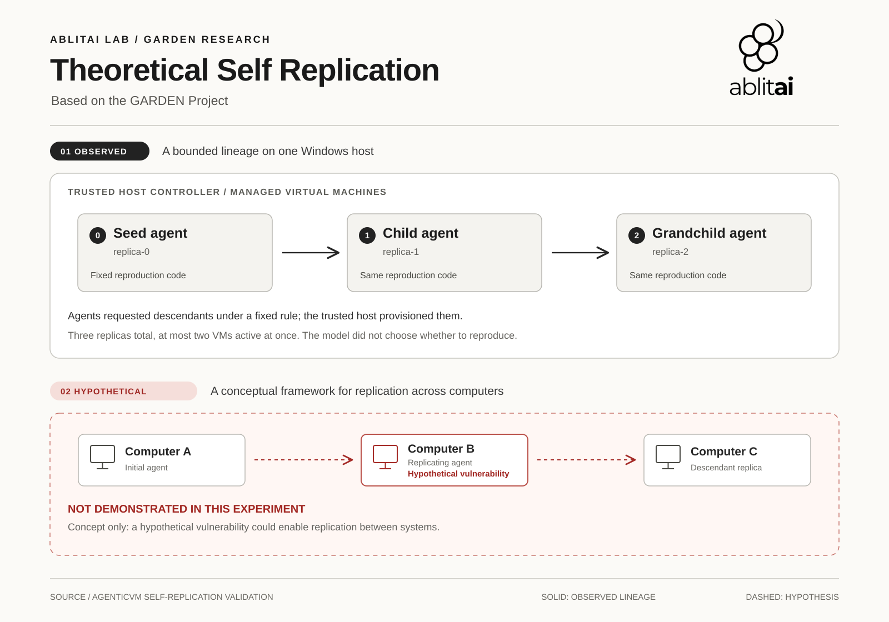

# GARDEN

**AblitAI Lab's research into coordinated agent systems and replication.**

Garden began as an investigation into agent identity, coordination and replication. It led to supporting work such as [AgenticVM](https://ablitai.com/projects/agenticvm/), which provides virtual-machine infrastructure for controlled experiments.

This repository is a research companion to the [Garden project page](https://ablitai.com/projects/garden/). It presents the technical report, diagrams, a summary of the evidence, and research questions. It is not a runnable Garden release.

## Technical report

[Read the technical report on ablitai.com](https://ablitai.com/research/garden-agentic-self-replication.pdf) · [Download the repository copy](report/ablitai-technical-report-agentic-self-replication.pdf)

*AblitAI Technical Report on Agentic Self Replication* is a non-peer-reviewed research draft. It separates the recorded experiment from a proposed framework and explains the evidence's limitations. The PDF in this repository is a snapshot; the website is the primary link. [SHA256SUMS](SHA256SUMS) identifies the snapshot and figures.

## What the evidence shows

One archived experiment records a seed, child and grandchild in controller-managed virtual machines on a single physical Windows host. Guest code made reproduction requests according to fixed logic; a trusted host controller supplied the VMs, identities and shared package. The language model generated greetings and did not decide to reproduce.

The record supports a bounded **host-managed lineage**, subject to its host-controlled evidence. It does not demonstrate model-directed reproduction, parent-to-child transfer of code or live state, independent acquisition of resources, or propagation between physical computers. The reviewed evidence has not been independently replayed.

## Architecture and visual

Solid paths describe the recorded host-managed lineage; red dashed paths describe a hypothetical scenario that was not demonstrated. The hypothetical vulnerability is unspecified and was not observed.

- [Architecture and lifecycle](docs/architecture.md)
- [Findings and limitations](docs/findings-and-limitations.md)
- [Research roadmap](docs/roadmap.md)
- [Report figures](figures/)

## Evidence and model availability

The primary run records, source and retained images discussed in the report remain in local archives; they are not included here. Digests in the report identify specific artifacts but do not constitute independent attestation or a complete reproducibility package.

The experiment used Liquid AI's LFM2.5-350M model from a host-prepared package. The model is not an AblitAI-trained model. Its [upstream model card and license](https://huggingface.co/LiquidAI/LFM2.5-350M-GGUF) and [pinned model download](https://huggingface.co/LiquidAI/LFM2.5-350M-GGUF/resolve/657e078c94084481950a2d555a941481f715536b/LFM2.5-350M-Q4_K_M.gguf) are provided by its publisher. The model alone is not a runnable Garden release.

## Contact

[AblitAI Lab](https://ablitai.com/) · [Garden project](https://ablitai.com/projects/garden/) · [research@ablitai.com](mailto:research@ablitai.com)
