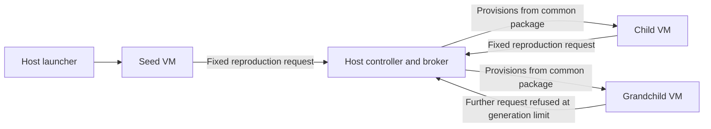

# Garden architecture

Garden studies coordinated agent networks, membership and replication. AgenticVM supplies virtual-machine lifecycle and guest-environment infrastructure. The evaluated case is a bounded, host-managed lineage on one physical Windows host: a seed requested a child, and that child requested a grandchild.

This describes the implementation examined in the [technical report](https://ablitai.com/research/garden-agentic-self-replication.pdf), a **non-peer-reviewed research draft**, rather than every implementation or later design associated with Garden. The [public project page](https://ablitai.com/projects/garden/) places the experiment in the broader research direction.

## Responsibilities

| Layer | Responsibility in the recorded experiment |
| --- | --- |
| Prepared inputs | Common pinned package containing guest code, model weights, inference runtime and boot image; identities allocated before the seed started. |
| Host | Launcher starts the seed. Controller provisions VM disks, schedules descendants, checks policy and accounts for requests. Broker carries messages and can read their contents. |
| Guest | Checks its reproduction-source digest, registers identity and generation, generates a model greeting and submits a reproduction request through fixed program logic. |

The model was Liquid AI's LFM2.5-350M-Q4_K_M. It supplied greeting text; it did not choose whether to reproduce, select a destination or allocate resources. The [upstream model card and license](https://huggingface.co/LiquidAI/LFM2.5-350M-GGUF) describe the external model resource. Model weights alone are not a runnable Garden release.

## Recorded request and provisioning path

All three replica VMs belong to one physical host. Each accepted request is first reserved or queued; a later launch is a separate event. The controller launched the grandchild after an active slot became available. Recorded policy allowed three total replicas, at most two active replica VMs, generations zero through two, and at most one child per agent. Each replica VM had a 512 MiB allocation; this is not a total-system memory measurement.

Common source provisioning is central to the interpretation. Matching source digests do not demonstrate a parent transferring source bytes or live state to a child. The host supplied the package, identities and execution substrate. The model was included in that host-supplied package; no guest-side internet download was demonstrated.

## Trust and design boundaries

The guests had loopback-only networking and communicated with the broker through authenticated virtio-serial links. Mutual TLS protected those guest-to-broker links, while the broker could read application messages. This does not establish confidentiality from the broker.

The controller, guest reports and checkpoint journal belong to the same host-managed evidence boundary. Their agreement supports the reported reconstruction under that trust assumption. It is not independent attestation.

Later descriptions of owner-signed policy, Mother admission authority and blind routing are broader design work. They must not be read back into this earlier experiment. See [findings and limitations](findings-and-limitations.md) for the observed result and [roadmap](roadmap.md) for proposed evaluations.
